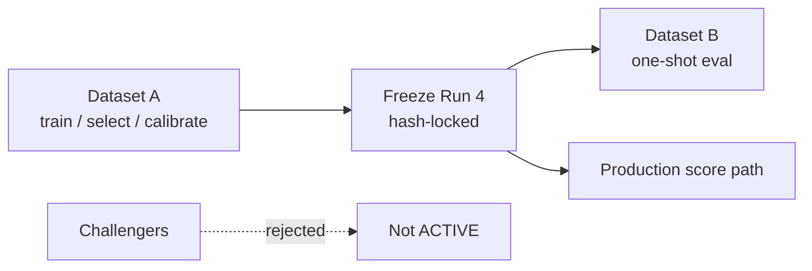
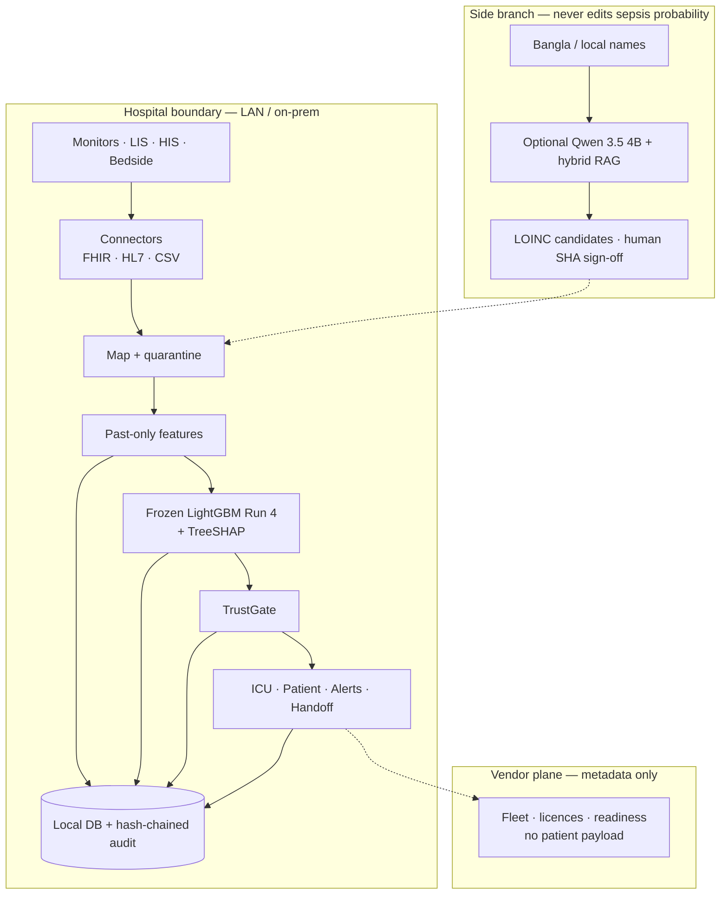

# Auralis

**Hospital-local ICU early-warning intelligence** with forward-deployed engineering.  
Public brand: **Auralis** · Research track: **PredictRx Sentinel**

<p align="center">
  <strong>Research prototype — not approved for clinical use.</strong><br/>
  Public demo = synthetic / PhysioNet replay only. Risk scores support clinical judgment; they do not replace it.<br/>
  Not validated on Bangladeshi patients. No claim of lives saved, paid pilots, or regulatory approval.
</p>

---

## Production model (promoted · frozen · hash-locked)

The live scorer is **only** Frozen LightGBM **Run 4** — not Qwen, not a Transformer, not any challenger.

| | |
|---|---|
| **Version** | `v0.2.0-202609281906` (`RUN4-FROZEN`) |
| **Family** | LightGBM + **isotonic** calibration + TreeSHAP drivers |
| **SHA-256** | `a7dcf5f4b2f00927c17d2468cba144b3db4642ccb5a9c946b484958a0413532d` |
| **Pointer** | `ml/artifacts/models/ACTIVE.json` → `run4_frozen/model.joblib` |
| **Train** | PhysioNet Challenge 2019 **Dataset A** · patient-wise split · seed **42** |
| **Features** | **673** past-only temporal / missingness / rate features (no future leak) |
| **Internal test (A)** | AUROC **0.821** · AUPRC **0.109** · high-risk utility **0.244** |
| **Holdout Dataset B** *(scored once after freeze)* | AUROC **0.808** · AUPRC **0.079** · utility **0.238** |
| **Baselines on B** | Clinical-rule utility **0.053** · logistic **0.124** → Run 4 wins this preregistered comparison |
| **Calibration honesty** | B slope ~**0.80** → **local recalibration required** before any live hospital use |

**Rejected for production** (ledgered; never promoted to `ACTIVE.json`): 36-trial LightGBM/CatBoost search · GRU-D · TCN · Graph-Hazard · Run4+TCN blend · Residual-Hazard · 5-member bootstrap ensemble.  
**Not claimed:** a trained time-series Transformer. **Qwen 3.5 4B** = Bangla/local → LOINC side-branch only.

Full matrix → [docs/EXPERIMENT_MATRIX.md](docs/EXPERIMENT_MATRIX.md) · cards → [model-card](docs/model-card.md) · [data-card](docs/data-card.md) · [ledger](docs/experiment-ledger.md).



---

| | |
|---|---|
| **Live demo** | https://predictrx-sentinel-demo.onrender.com |
| **In-app docs** | `/docs` (live model hash + architecture) |
| **API OpenAPI** | Demo `/api/docs` (Swagger; FastAPI `/docs` behind the proxy) |
| **GitHub Pages** | https://tanvir-ahmed-siddique-ctrl.github.io/Sepsis/ |
| **Docker Hub** | `tanvirdoc02/predictrx-sentinel` (`latest` · git SHA tags) |
| **Challenge** | HealthSphere AI · PredictRx · International AI Builders Congress 2026 |

Core set (full files kept): [LAYERS](docs/LAYERS.md) · [EXPERIMENT_MATRIX](docs/EXPERIMENT_MATRIX.md) · [DOCUMENTATION_INDEX](docs/DOCUMENTATION_INDEX.md) · [GAPS_AND_RISKS](docs/GAPS_AND_RISKS.md) · [architecture](docs/architecture.md) · [trustgate](docs/trustgate-layers.md) · [judge-evidence-matrix](docs/judge-evidence-matrix.md) · [safety-ethics](docs/safety-ethics.md) · [AGENTS.md](AGENTS.md)

---

## What it is

Auralis is an **on-premises decision-support stack** for adult ICU early warning:

1. **Connect** hospital feeds (FHIR R4, HL7 v2, CSV) with unit/LOINC quarantine  
2. **Score** with the **frozen** LightGBM Run 4 model above  
3. **Guard** with **TrustGate** (Alert / Watch / Verify data / Abstain) before interruptive alerts  
4. **Work** in role-separated doctor, nurse, admin, and clinical-IT surfaces  
5. **Deploy** site-by-site via forward-deployed engineering — not a cloud EHR plug-in fantasy  

---

## System architecture



---

## Core set · LAYERS

Seven engineering layers (source-linked). Full Mermaid + role/safety diagrams: **[docs/LAYERS.md](docs/LAYERS.md)**.

| Layer | Responsibility | Evidence |
|-------|----------------|----------|
| **L1 Connect** | FHIR / HL7 / CSV, idempotency, quarantine | `backend/app/integrations/` |
| **L2 Map** | Local/Bangla → LOINC (proposal only) | `backend/app/integrations/copilot.py` |
| **L3 Features** | Past-only 24h window; no future leak | `ml/`, `backend/app/services/engine.py` |
| **L4 Score** | Frozen LightGBM Run 4 + isotonic + TreeSHAP | `ml/artifacts/models/run4_frozen/` |
| **L5 Guard** | TrustGate Verify / Abstain | `backend/app/trustgate.py` |
| **L6 Mode** | demo · silent · readiness gates | `backend/app/site.py`, `pilot.py` |
| **L7 Work** | Role workspaces + audit | `frontend/app/` |

---

## Core set · EXPERIMENT_MATRIX

Verified research tracks vs the **only** active artifact. Full table: **[docs/EXPERIMENT_MATRIX.md](docs/EXPERIMENT_MATRIX.md)**.

| Family | Disposition |
|--------|-------------|
| Clinical-rule + logistic baselines | Reference (Run 4 beats on Set B utility) |
| 36-trial LightGBM / CatBoost (`TABULAR-AONLY-01`) | **Rejected** |
| 5-member Run 4 bootstrap ensemble | **Rejected** (val utility not better) |
| GRU-D · TCN · Graph-Hazard · Run4+TCN blend | **Rejected** for prod |
| Residual-Hazard (`RESIDUAL-HAZARD-01`) | **Rejected** (own freeze ≠ `ACTIVE`) |
| Time-series Transformer | **Not run** — do not claim |
| Qwen 3.5 4B | Mapping only — **not** the sepsis model |

---

## Core set · DOCUMENTATION_INDEX

Audience map for judges, ML reviewers, hospital IT, and FDE partners: **[docs/DOCUMENTATION_INDEX.md](docs/DOCUMENTATION_INDEX.md)**.

| Audience | Open first |
|----------|------------|
| Judges (3 min) | This README → LAYERS → EXPERIMENT_MATRIX → live demo |
| ML / research | model-card · data-card · experiment-ledger · matrix |
| Hospital IT / security | architecture · integration · operations · operator-guide |
| Clinical safety | trustgate-layers · safety-case · safety-ethics |
| FDE / commercial | `docs/business/*` *(hypothesis-aware)* |
| Navigable site | [GitHub Pages](https://tanvir-ahmed-siddique-ctrl.github.io/Sepsis/) · in-app `/docs` |

---

## Core set · GAPS_AND_RISKS

Open honesty register: **[docs/GAPS_AND_RISKS.md](docs/GAPS_AND_RISKS.md)**.

| Highlight | Status |
|-----------|--------|
| Most challenger artifacts gitignored (by design) | Cite matrix + ledger; don’t imply GitHub hosts all joblibs |
| Transfer Shield S7 | Documentation / fairness-audit trigger — not a separate auto-stop microservice |
| Public demo ≠ live hospital EHR | Policy closed |
| Pricing / WTP / grants / paid pilots | **Hypothesis** unless evidenced — none claimed here |
| Accidental scratch logs (`tmp_*.log`, `torch_install.log`) | Removed from public tree; keep evidence `eval_log_setB.txt` only |

---

## Core set · architecture

Hospital-local clinical plane + patient-free vendor plane. Full write-up: **[docs/architecture.md](docs/architecture.md)** · audit: [current-state-audit](docs/architecture/current-state-audit.md).

| Plane | Stack | Notes |
|-------|--------|------|
| Clinical API | FastAPI · SQLAlchemy · SQLite/Postgres | `/v1/*`, OpenAPI at API `/docs` |
| UI | Next.js · TypeScript · Tailwind · ECharts | Public site + hospital app + vendor portal |
| Auth | Local accounts / OIDC / demo roles | Doctor · nurse · admin · clinical IT · operator |
| Audit | Hash-chained prediction / action log | Hospital-local |
| MCP | 3 read-only servers | Ops · docs · mapping — **no PHI tools** |
| Edge | Optional HL7 MLLP / spool | `edge/` |

---

## Core set · trustgate

Deterministic data-quality gate on every score — **not** an LLM. Full layers: **[docs/trustgate-layers.md](docs/trustgate-layers.md)**.

- Inputs checked for coverage, freshness, units/shift → **Alert / Watch / Verify data / Abstain**
- Code: `backend/app/trustgate.py`
- Honest limit: at matched sensitivity, false-alert *benefit* is **not** statistically established
- **Transfer Shield / readiness** (silent pilot, freeze, quarantine, habit fingerprint): [innovation-adoption-barriers](docs/innovation-adoption-barriers.md)

---

## Core set · judge-evidence-matrix

Congress / judge claim → file mapping: **[docs/judge-evidence-matrix.md](docs/judge-evidence-matrix.md)**.  
Use it to answer “where is the proof?” without inventing metrics.

---

## Core set · safety-ethics

Clinical + research boundaries: **[docs/safety-ethics.md](docs/safety-ethics.md)** · [safety-case](docs/safety-case.md).

- Decision support only; clinicians remain accountable  
- No Bangladesh patient validation claimed  
- Patient data is never a product for sale  
- Public demo = PhysioNet / synthetic replay only  

---

## Core set · AGENTS.md

Operator / agent conventions for this repo: **[AGENTS.md](AGENTS.md)** (root stays public; prompt packs stay local).

---

## Local terminology AI (isolated)

| | |
|---|---|
| Runtime | Optional Ollama `qwen3.5:4b` + optional embeddings |
| Job | Propose Bangla / BD lab aliases → LOINC from retrieved candidates only |
| Contract | JSON schema; out-of-candidate answers discarded; human registry SHA |
| Isolation | Score path never calls the LLM (`engine.py` → frozen joblib only) |

Benchmark (internal): [docs/evaluation/copilot-retrieval-bench-v1.json](docs/evaluation/copilot-retrieval-bench-v1.json).

---

## Synthetic public demo vs hospital-local design

| | Public demo | Intended hospital install |
|---|-------------|---------------------------|
| Data | PhysioNet replay + synthetic | Hospital-local observations only |
| Mode | `demo` | Silent → gated live |
| EHR | **Not** a live hospital integration | FHIR / HL7 / CSV connectors on LAN |
| Vendor | N/A | Metadata-only fleet heartbeat |
| Image | `tanvirdoc02/predictrx-sentinel` | Same stack pattern; site compose / FDE install |

Guides: [operator-guide](docs/operator-guide.md) · [operations](docs/operations.md) · `docker-compose.yml` + `docker-compose.site.yml`.

---

## FDE service lifecycle (business model)

Auralis is **hospital technology enablement**, not model-file licensing alone.

| Stage | Intent | Status label |
|-------|--------|----------------|
| **Discover** | Workflow + infrastructure readiness | Product surfaces / checklists |
| **Bridge Start** | CSV / batch | Implemented connectors |
| **Bridge Connect** | HL7 / FHIR / approved APIs | Implemented + edge path |
| **Validated Evaluation** | Silent / retrospective under governance | Protocol + pilot gates; **no paid pilot claimed** |
| **Clinical Workflow Licence** | Annual site licence | **Commercial hypothesis** |
| **Managed Edge** | Local install + ops | Playbooks; delivery is FDE work |
| **Expansion** | More units / sites | Hypothesis / roadmap |

Details: [business-model](docs/business/business-model.md) · [fde-delivery-playbook](docs/business/fde-delivery-playbook.md).  
Outside-repo blockers: [REAL_WORLD_ACTION_PLAN.md](REAL_WORLD_ACTION_PLAN.md).

---

## Repo layout

```
backend/        FastAPI · TrustGate · connectors · scoring
frontend/       Next.js · Auralis UI · /docs hub
ml/             Pipeline · frozen Run 4 · (local) challenger artifacts
docs/           Cards · ledger · layers · FDE · evidence · Pages hub
mcp-server/     Read-only operator / docs / mapping MCP
control-plane/  Patient-free vendor fleet
infra/          Docker · Congress preflight
edge/           Optional HL7 edge relay
knowledge/      Versioned non-causal evidence graphs
demo/           Replay assets (manifest + samples)
```

---

## Quick start

```powershell
Set-Location "…\PredictRx Sentinel"
py -3.11 -m venv .venv
.\.venv\Scripts\Activate.ps1
pip install -r ml\requirements.txt
pip install -e .\ml
pip install -r backend\requirements.txt

# API
Set-Location backend
alembic upgrade head
uvicorn app.main:app --reload

# UI (other terminal)
Set-Location frontend
npm ci
npm run dev
```

- UI: http://localhost:3000  
- API OpenAPI: http://localhost:8000/docs  
- Tests: `cd backend && pytest -q` · `cd frontend && npm test`  
- Compose: `docker compose up --build`  
- Public demo image: `docker build --platform linux/amd64 -f infra/Dockerfile.demo -t tanvirdoc02/predictrx-sentinel:latest .`  
- Congress preflight: `python infra\congress_demo.py check`

---

## Limitations & roadmap

- US PhysioNet training distribution ≠ Bangladesh ICU reality  
- No claim of clinical outcome improvement  
- TrustGate alert-burden benefit unproven at matched sensitivity  
- Live HIS connection requires hospital MoU, legal basis, and FDE work outside this repo  
- Frozen Run 4 is **immutable** — challengers stay off `ACTIVE.json` until a new ledgered promotion  

---

## Disclaimer

Trained on publicly available US ICU data. **Not** for clinical use. **Not** a live hospital EHR integration on the public demo. Patient data is never a product for sale.
