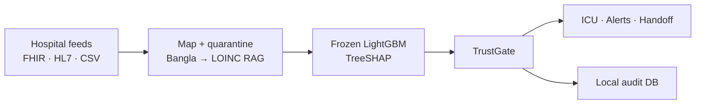

# Auralis (PredictRx Sentinel)

Hospital-local ICU early-warning software with **forward deployed engineering**.  
Public brand: **Auralis** · Research track name: PredictRx Sentinel.

> Research prototype — **not approved for clinical use**. Synthetic / PhysioNet replay on the public demo. The risk score supports, but does not replace, clinical judgment.

**Live demo:** https://predictrx-sentinel-demo.onrender.com  
**Layers (visual):** [docs/LAYERS.md](docs/LAYERS.md) — open this first for judges  
**Full build chronicle + cleaned prompts:** [docs/PROJECT_BUILD_CHRONICLE.md](docs/PROJECT_BUILD_CHRONICLE.md)  
**Submission wrap-up:** [docs/submission/WRAP_UP_CHECKLIST.md](docs/submission/WRAP_UP_CHECKLIST.md)

## Challenge

- **Domain:** HealthSphere AI  
- **Track:** PredictRx  
- **Event:** International AI Builders Congress 2026  

---

## System at a glance (layers)



| Layer | Job |
|-------|-----|
| **Connect** | FHIR R4 · HL7 v2 · CSV · vendor adapter · quarantine |
| **Score** | Past-only features · frozen LightGBM Run 4 · AUROC ~0.81 on Dataset B (once) |
| **Guard** | TrustGate Verify / Abstain before interruptive alerts |
| **Work** | Role-separated doctor · nurse · admin · clinical IT · vendor |
| **Deploy** | FDE: assess → integrate → silent eval → train → support · worldwide site-by-site |

Full stack diagrams (safety, roles, packages, evidence, Congress map): **[docs/LAYERS.md](docs/LAYERS.md)**.

---

## What V1 does

Every hour, for each adult ICU patient with ≥4 hours of observations:

1. Ingest latest vitals / labs / history (24-hour window)
2. Produce a calibrated PhysioNet Challenge-label early-warning score
3. Classify: Stable · Watch · High risk · Insufficient data
4. Apply TrustGate: Alert · Watch · Verify data · Abstain
5. Show grouped TreeSHAP influence, per-signal freshness, perturbation stability, and a data-availability shift proxy
6. Interrupt only when High Risk passes the reliability gate; clinician acknowledgement / dismissal / escalation remains mandatory
7. Persist encounter state and a hash-chained audit trail in SQLite or PostgreSQL

The historical frozen model uses a Challenge-compatible label that becomes
positive six hours before defined onset and remains positive afterward. Its
score is not presented as an exact incident six-hour probability. Separate
1/3/6/12-hour incident targets are implemented and used by the temporal
multi-horizon hazard challengers (research only).

## Repo layout

```
docs/           Product, architecture, LAYERS.md, ethics, cards
ml/             Data pipeline, training, evaluation
backend/        FastAPI inference + TrustGate + connectors
frontend/       Next.js hospital + public site (Auralis)
demo/           Held-out patient replay assets
knowledge/      Versioned non-causal evidence graph
control-plane/  Vendor fleet (patient-free)
infra/          Docker helpers
.github/        CI checks
```

## Quick start (local)

```powershell
Set-Location "C:\Users\Tanvir Ahmed\Downloads\PredictRx Sentinel 2\PredictRx Sentinel"
py -3.11 -m venv .venv
.\.venv\Scripts\Activate.ps1
python -m pip install --upgrade pip
pip install -r ml\requirements.txt -r backend\requirements.txt
pip install -e .\ml

# Terminal 1
Set-Location backend
alembic upgrade head
uvicorn app.main:app --reload

# Terminal 2
Set-Location frontend
npm ci
npm run dev
```

Dashboard: http://localhost:3000  
API docs: http://localhost:8000/docs  

For a non-demo site using local accounts, create the first administrator before
starting the API:

```powershell
Set-Location backend
python -m app.ops_cli bootstrap-admin --user-id site.admin --display-name "Site Administrator" --password "temporary-12+-character-password"
```

The administrator must change that password at first sign-in. Local accounts
support unit scoping, scrypt password hashes, lockout, optional TOTP, revocable
sessions, and a short-lived personal PIN for shared ward tablets.

Tests: `cd backend && pytest -q` and `cd frontend && npm test`.

Offline/local Compose path: `docker compose up --build`. A hospital silent
pilot uses the site override, which disables demo mode and requires every
secret:

Congress preflight after the local stack is healthy:

```powershell
.\.venv\Scripts\python.exe infra\congress_demo.py check
```

```bash
docker compose -f docker-compose.yml -f docker-compose.site.yml --env-file .env.site up -d --build
```

See [operations](docs/operations.md) for authentication, monitoring, backup and
the readiness gates. Direct public deployment is intentionally outside this
implementation pass.

## Data

Primary dataset: [PhysioNet 2019 Sepsis Challenge](https://physionet.org/content/challenge-2019/1.0.0/) (CC BY 4.0).  
Raw data is **not** committed. See `docs/data-card.md` and `ml/README.md`.

Raw PSV files for training sets A (20,336 patients) and B (20,000 patients)
are present locally and match the recorded checksum manifest. Feature files
were rebuilt on 2026-09-30 with a streaming, atomic writer; the Dataset A
patient split is byte-identical to Run 4, and the frozen model reproduces its
recorded internal-test metrics on the rebuilt file. The earlier truncated
Parquet files are kept in `ml/data/processed/corrupt_backup_20260930/`.

## Evidence at a glance

- **Dataset B (site-held-out, retrospective):** frozen Run 4 AUROC 0.808
  (95% CI 0.797–0.820), AUPRC 0.079 (0.071–0.090), high-risk utility 0.238
  (0.213–0.263). It beat the clinical-rule (utility 0.053) and logistic (0.124)
  baselines in a preregistered one-time comparison. Calibration slope 0.80
- **Challenger search:** a 36-trial Dataset A-only LightGBM/CatBoost search
  lost to Run 4 on the locked internal test and was rejected
- **Temporal / Graph-Hazard:** 7 sequence models (GRU-D, TCN, organ-graph
  Graph-Hazard ablations). None beat the tree on utility; a Run 4 + TCN blend
  raised test AUPRC from 0.109 to 0.117 but not utility, so it was rejected
- **Residual-Hazard:** healthy-reference residuals passed an internal
  development gate, but the frozen candidate lost its one-time Dataset B
  comparison (utility 0.109 against Run 4's 0.238) and was rejected
- **TrustGate:** at matched sensitivity, the false-alert benefit is not
  statistically established
- **Honest finding:** measurement-pattern features alone reach ~89% of the
  full model's cross-validated utility, so local validation is essential

Details: [model card](docs/model-card.md) and
[experiment ledger](docs/experiment-ledger.md).

## Documentation

- [Founder operator guide: map, deploy, live link, install, security, offboarding](docs/operator-guide.md)
- [Strategic plan: research, commercial and public-interest tracks, finance, GTM](docs/business/strategic-plan.md)
- [Deployment innovation plan: adoption barriers, integration, monitoring, business and 10-year gates](docs/business/deployment-innovation-plan.md)
- [Locked decisions](docs/DECISIONS.md)
- [Product brief](docs/product-brief.md)
- [Production operating model](docs/product-operating-model.md)
- [Visual layers (Mermaid)](docs/LAYERS.md)
- [Full project build chronicle + prompt archive](docs/PROJECT_BUILD_CHRONICLE.md)
- [Architecture](docs/architecture.md)
- [Submission wrap-up checklist](docs/submission/WRAP_UP_CHECKLIST.md)
- [Hospital data integration](docs/integration.md)
- [Hospital onboarding and data operations](docs/hospital-onboarding.md)
- [AI Congress demo runbook](docs/congress-demo-runbook.md)
- [Site operations and readiness gates](docs/operations.md)
- [Scalability and production hardening](docs/scalability.md)
- [Safety case](docs/safety-case.md)
- [Judge evidence matrix](docs/judge-evidence-matrix.md)
- [Technical production evidence](docs/technical-production-evidence.md)
- [Global corroboration (published alignment)](docs/global-corroboration.md)
- [International deployment validation (timeline)](docs/international-deployment-validation.md)
- [Innovation: adoption barriers (lock-in + transfer)](docs/innovation-adoption-barriers.md)
- [Vendor Adapter contract v1](docs/adapters/vendor-adapter-contract.v1.json)
- [Standards alignment](docs/standards-alignment.md)
- [NRB / global builder pack](docs/nrb-global-builder-pack.md)
- [Fleet enrolment & release rings](docs/fleet-enrolment-and-release-rings.md)
- [Contributing](CONTRIBUTING.md)
- [FDE pilot and business pack](docs/business/business-model.md)
- [Congress evidence sprint](docs/business/congress-evidence-sprint.md)
- [Congress judge one-pager](docs/business/congress-judge-one-pager.md)
- [Top-band judging evidence plan](docs/business/top-band-evidence-plan.md)
- [Investor memo](docs/business/investor-memo.md)
- [Investor data-room index](docs/business/investor-data-room-index.md)
- [Hospital, LOI, adviser and NRB proof kit](docs/business/external-proof-kit.md)
- [Congress portal answers](docs/submission/congress-portal-answers.md)
- [Read-only MCP server](mcp-server/) and [agent invariants](AGENTS.md)
- [Vendor fleet console (patient-free control plane)](control-plane/README.md)
- [Mapping-copilot benchmark results](docs/evaluation/copilot-retrieval-bench-v1.json)
- [Data card](docs/data-card.md)
- [Model card](docs/model-card.md)
- [Safety & ethics](docs/safety-ethics.md)
- [Current readiness passport](docs/hospital-readiness-passport-current.md)
- [Adoption / SafeLaunch plan](docs/adoption-plan.md)
- [Experiment ledger](docs/experiment-ledger.md)
- [Build schedule](docs/schedule.md)

## Disclaimer

Trained on publicly available US ICU data. Not validated for Bangladeshi patients. Not for clinical use.
