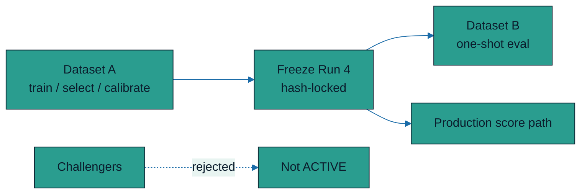
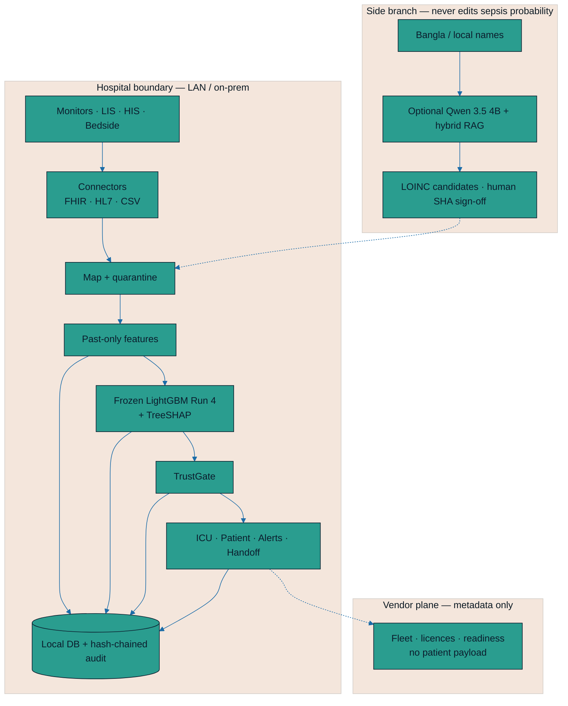

# Auralis

<p align="center">
  <strong>Hospital-local ICU early-warning intelligence</strong><br/>
  Public brand <b>Auralis</b> · Research track <b>PredictRx Sentinel</b> · FDE-led hospital enablement
</p>

<p align="center">
  <a href="https://predictrx-sentinel-demo.onrender.com"></a>
  <a href="https://tanvir-ahmed-siddique-ctrl.github.io/Sepsis/"></a>
  <a href="https://hub.docker.com/r/tanvirdoc02/predictrx-sentinel"></a>
</p>

<p align="center">
  
  
  
  
  
  
</p>

> **Research prototype — not approved for clinical use.**  
> Public demo = synthetic / PhysioNet replay only. Scores support judgment; they do not replace it.  
> Not validated on Bangladeshi patients. No claim of lives saved, paid pilots, or regulatory approval.

---

## Production model — promoted · frozen · hash-locked

<p align="center">
  
  
  
</p>

The live scorer is **only** Frozen LightGBM **Run 4** — not Qwen, not a Transformer, not any challenger.

| Field | Value |
|:------|:------|
| **Version** | `v0.2.0-202609281906` (`RUN4-FROZEN`) |
| **Family** | LightGBM + **isotonic** calibration + TreeSHAP drivers |
| **SHA-256** | `a7dcf5f4b2f00927c17d2468cba144b3db4642ccb5a9c946b484958a0413532d` |
| **Pointer** | `ml/artifacts/models/ACTIVE.json` → `run4_frozen/model.joblib` |
| **Train** | PhysioNet Challenge 2019 **Dataset A** · patient-wise split · seed **42** |
| **Features** | **673** past-only temporal / missingness / rate features (no future leak) |
| **Internal test (A)** | AUROC **0.821** · AUPRC **0.109** · high-risk utility **0.244** |
| **Holdout Dataset B** *(once after freeze)* | AUROC **0.808** · AUPRC **0.079** · utility **0.238** |
| **Baselines on B** | Clinical-rule **0.053** · logistic **0.124** → Run 4 wins |
| **Calibration honesty** | B slope ~**0.80** → **local recalibration required** before any live use |

**Rejected for production** (ledgered; never on `ACTIVE.json`): 36-trial LightGBM/CatBoost · GRU-D · TCN · Graph-Hazard · Run4+TCN blend · Residual-Hazard · 5-member bootstrap.  
**Not claimed:** trained time-series Transformer. **Qwen 3.5 4B** = Bangla/local → LOINC only.



Evidence: [EXPERIMENT_MATRIX](docs/EXPERIMENT_MATRIX.md) · [model-card](docs/model-card.md) · [data-card](docs/data-card.md) · [ledger](docs/experiment-ledger.md)

---

## Quick links

| | |
|:--|:--|
| **Live demo** | https://predictrx-sentinel-demo.onrender.com |
| **In-app docs** | `/docs` (live model hash + architecture) |
| **API OpenAPI** | Demo `/api/docs` |
| **GitHub Pages** | https://tanvir-ahmed-siddique-ctrl.github.io/Sepsis/ |
| **Docker Hub** | `tanvirdoc02/predictrx-sentinel` (`latest` · `judge` · git SHA) |
| **Challenge** | HealthSphere AI · PredictRx · International AI Builders Congress 2026 |

---

## Documentation pack (everything we published)

All engineering docs stay as **full files**; this README is the colorful landing page that points into them.

| Badge | Doc | What it is |
|:------|:----|:-----------|
|  | [DOCUMENTATION_INDEX.md](docs/DOCUMENTATION_INDEX.md) | Audience map — judges / ML / IT / FDE |
|  | [LAYERS.md](docs/LAYERS.md) | Mermaid system / role / safety diagrams |
|  | [EXPERIMENT_MATRIX.md](docs/EXPERIMENT_MATRIX.md) | Verified model comparison + disposition |
|  | [GAPS_AND_RISKS.md](docs/GAPS_AND_RISKS.md) | Open history / risks / honesty register |
|  | [docs/index.html](docs/index.html) + [_sidebar.md](docs/_sidebar.md) | Docsify GitHub Pages hub |
|  | [architecture.md](docs/architecture.md) | Backend / frontend / security planes |
|  | [trustgate-layers.md](docs/trustgate-layers.md) | Alert / Watch / Verify / Abstain |
|  | [judge-evidence-matrix.md](docs/judge-evidence-matrix.md) | Claim → evidence file map |
|  | [safety-ethics.md](docs/safety-ethics.md) | Clinical + research boundaries |
|  | [AGENTS.md](AGENTS.md) | Repo operator / agent conventions |

**Core set (kept as links + sections below):**  
[LAYERS](docs/LAYERS.md) · [EXPERIMENT_MATRIX](docs/EXPERIMENT_MATRIX.md) · [DOCUMENTATION_INDEX](docs/DOCUMENTATION_INDEX.md) · [GAPS_AND_RISKS](docs/GAPS_AND_RISKS.md) · [architecture](docs/architecture.md) · [trustgate](docs/trustgate-layers.md) · [judge-evidence-matrix](docs/judge-evidence-matrix.md) · [safety-ethics](docs/safety-ethics.md) · [AGENTS.md](AGENTS.md)

Also useful: [model-card](docs/model-card.md) · [data-card](docs/data-card.md) · [experiment-ledger](docs/experiment-ledger.md) · [operations](docs/operations.md) · [operator-guide](docs/operator-guide.md) · [business-model](docs/business/business-model.md) · [REAL_WORLD_ACTION_PLAN](REAL_WORLD_ACTION_PLAN.md)

---

## What it is

Auralis is an **on-premises decision-support stack** for adult ICU early warning:

1. **Connect** hospital feeds (FHIR R4, HL7 v2, CSV) with unit/LOINC quarantine  
2. **Score** with the **frozen** LightGBM Run 4 model above  
3. **Guard** with **TrustGate** (Alert / Watch / Verify data / Abstain)  
4. **Work** in role-separated doctor, nurse, admin, and clinical-IT surfaces  
5. **Deploy** site-by-site via forward-deployed engineering  

---

## System architecture



---

## Core set · LAYERS

Full diagrams: **[docs/LAYERS.md](docs/LAYERS.md)**

| Layer | Color cue | Responsibility | Evidence |
|:------|:----------|:---------------|:---------|
| **L1 Connect** |  | FHIR / HL7 / CSV, quarantine | `backend/app/integrations/` |
| **L2 Map** |  | Local/Bangla → LOINC (proposal) | `backend/app/integrations/copilot.py` |
| **L3 Features** |  | Past-only 24h window | `ml/`, `engine.py` |
| **L4 Score** |  | Frozen Run 4 + TreeSHAP | `ml/artifacts/models/run4_frozen/` |
| **L5 Guard** |  | TrustGate Verify / Abstain | `backend/app/trustgate.py` |
| **L6 Mode** |  | demo · silent · gates | `site.py`, `pilot.py` |
| **L7 Work** |  | Role workspaces + audit | `frontend/app/` |

---

## Core set · EXPERIMENT_MATRIX

Full table: **[docs/EXPERIMENT_MATRIX.md](docs/EXPERIMENT_MATRIX.md)**

| Family | Status |
|:-------|:-------|
| Clinical-rule + logistic baselines |  |
| 36-trial LightGBM / CatBoost |  |
| 5-member Run 4 bootstrap |  |
| GRU-D · TCN · Graph-Hazard · blend |  |
| Residual-Hazard |  |
| Time-series Transformer |  |
| Qwen 3.5 4B |  |
| **Frozen LightGBM Run 4** |  |

---

## Core set · DOCUMENTATION_INDEX

**[docs/DOCUMENTATION_INDEX.md](docs/DOCUMENTATION_INDEX.md)** — who opens what.

| Audience | Start here |
|:---------|:-----------|
| Judges (3 min) | This README → LAYERS → EXPERIMENT_MATRIX → live demo |
| ML / research | model-card · data-card · ledger · matrix |
| Hospital IT | architecture · integration · operations |
| Clinical safety | trustgate · safety-case · safety-ethics |
| FDE / commercial | `docs/business/*` *(hypothesis-aware)* |
| Pages hub | [github.io/Sepsis](https://tanvir-ahmed-siddique-ctrl.github.io/Sepsis/) |

---

## Core set · GAPS_AND_RISKS

**[docs/GAPS_AND_RISKS.md](docs/GAPS_AND_RISKS.md)**

| Highlight | Label |
|:----------|:------|
| Challenger artifacts mostly gitignored |  |
| Transfer Shield S7 |  — not a separate auto-stop service |
| Public demo ≠ live EHR |  |
| Pricing / paid pilots / grants |  |
| Scratch logs removed from git |  · keep `eval_log_setB.txt` |

---

## Core set · architecture

**[docs/architecture.md](docs/architecture.md)** · [current-state-audit](docs/architecture/current-state-audit.md)

| Plane | Stack | Notes |
|:------|:------|:------|
| Clinical API | FastAPI · SQLAlchemy | `/v1/*`, OpenAPI at API `/docs` |
| UI | Next.js · Tailwind · ECharts | Public + hospital + vendor |
| Auth | Local / OIDC / demo roles | Doctor · nurse · admin · clinical IT |
| Audit | Hash-chained | Hospital-local |
| MCP | 3 read-only servers | Ops · docs · mapping — **no PHI tools** |
| Edge | Optional HL7 MLLP | `edge/` |

---

## Core set · trustgate

**[docs/trustgate-layers.md](docs/trustgate-layers.md)** · code `backend/app/trustgate.py`

| State | Meaning |
|:------|:--------|
|  | Interruptive path allowed (data + model agree) |
|  | Elevated — monitor, not necessarily interrupt |
|  | Quality / freshness / unit issue |
|  | Do not interrupt — insufficient trustworthy input |

Honest limit: false-alert *benefit* at matched sensitivity is **not** statistically established.  
Transfer Shield / readiness: [innovation-adoption-barriers](docs/innovation-adoption-barriers.md).

---

## Core set · judge-evidence-matrix

**[docs/judge-evidence-matrix.md](docs/judge-evidence-matrix.md)** — claim → proof file. Use before inventing metrics.

---

## Core set · safety-ethics

**[docs/safety-ethics.md](docs/safety-ethics.md)** · [safety-case](docs/safety-case.md)

- Decision support only · clinicians remain accountable  
- No Bangladesh patient validation claimed  
- Patient data is never a product for sale  
- Public demo = PhysioNet / synthetic only  

---

## Core set · AGENTS.md

**[AGENTS.md](AGENTS.md)** — public repo conventions (prompt packs stay local / `LOCAL_ONLY/`).

---

## Local terminology AI (isolated)

| | |
|:--|:--|
| Runtime | Optional Ollama `qwen3.5:4b` |
| Job | Bangla / BD lab aliases → LOINC candidates |
| Isolation | Score path **never** calls the LLM |
| Bench | [copilot-retrieval-bench-v1.json](docs/evaluation/copilot-retrieval-bench-v1.json) |

---

## Synthetic demo vs hospital-local

| | Public demo | Intended hospital install |
|:--|:------------|:--------------------------|
| Data | PhysioNet + synthetic | Hospital-local only |
| Mode | `demo` | Silent → gated live |
| EHR | **Not** live hospital integration | FHIR / HL7 / CSV on LAN |
| Image | `tanvirdoc02/predictrx-sentinel` | Same pattern · site compose / FDE |

---

## FDE service lifecycle

| Stage | Intent | Label |
|:------|:-------|:------|
| Discover | Readiness | Implemented surfaces |
| Bridge Start | CSV / batch | Implemented |
| Bridge Connect | HL7 / FHIR | Implemented + edge |
| Validated Evaluation | Silent / retrospective | Protocol — **no paid pilot claimed** |
| Clinical Workflow Licence | Annual site |  |
| Managed Edge | Local ops | Playbooks / FDE |
| Expansion | More sites | Roadmap |

[business-model](docs/business/business-model.md) · [fde-delivery-playbook](docs/business/fde-delivery-playbook.md) · [REAL_WORLD_ACTION_PLAN](REAL_WORLD_ACTION_PLAN.md)

---

## Repo layout

```
backend/        FastAPI · TrustGate · connectors · scoring
frontend/       Next.js · Auralis UI · /docs hub
ml/             Pipeline · frozen Run 4 · (local) challengers
docs/           Cards · ledger · layers · Pages hub · FDE
mcp-server/     Read-only MCP (ops · docs · mapping)
control-plane/  Patient-free vendor fleet
infra/          Docker · Congress preflight
edge/           Optional HL7 edge relay
demo/           Replay assets
```

---

## Quick start

```powershell
Set-Location "…\PredictRx Sentinel"
py -3.11 -m venv .venv
.\.venv\Scripts\Activate.ps1
pip install -r ml\requirements.txt
pip install -e .\ml
pip install -r backend\requirements.txt

# API
Set-Location backend
alembic upgrade head
uvicorn app.main:app --reload

# UI (other terminal)
Set-Location frontend
npm ci
npm run dev
```

- UI → http://localhost:3000  
- API OpenAPI → http://localhost:8000/docs  
- Tests → `cd backend && pytest -q` · `cd frontend && npm test`  
- Demo image → `docker build --platform linux/amd64 -f infra/Dockerfile.demo -t tanvirdoc02/predictrx-sentinel:latest .`

---

## Limitations & roadmap

- US PhysioNet ≠ Bangladesh ICU reality  
- No clinical outcome improvement claimed  
- TrustGate alert-burden benefit unproven at matched sensitivity  
- Live HIS needs MoU + legal basis + FDE work outside this repo  
- Frozen Run 4 is **immutable** until a new ledgered promotion  

---

## Disclaimer

Trained on publicly available US ICU data. **Not** for clinical use. **Not** a live hospital EHR integration on the public demo. Patient data is never a product for sale.
