# Auralis

<p align="center">
  
</p>

<p align="center">
  <b>Public brand · Auralis</b> &nbsp;·&nbsp; <b>Research track · PredictRx Sentinel</b> &nbsp;·&nbsp; <b>FDE-led hospital enablement</b><br/>
  HealthSphere AI · PredictRx · International AI Builders Congress 2026
</p>

<p align="center">
  <a href="https://predictrx-sentinel-demo.onrender.com"></a>
  <a href="https://predictrx-sentinel-demo.onrender.com/docs"></a>
  <a href="https://predictrx-sentinel-demo.onrender.com/api/docs"></a>
  <a href="https://tanvir-ahmed-siddique-ctrl.github.io/Sepsis/"></a>
  <a href="https://hub.docker.com/r/tanvirdoc02/predictrx-sentinel"></a>
  <a href="https://github.com/tanvir-ahmed-siddique-ctrl/Sepsis"></a>
</p>

<p align="center">
  
  
  
  
  
  
  
</p>

> **Research prototype — not approved for clinical use.**  
> Public demo = synthetic / PhysioNet replay only. Scores support clinical judgment; they do not replace it.  
> Not validated on Bangladeshi patients. No claim of lives saved, paid pilots, or regulatory approval.  
> Everything below is either **measured**, **implemented**, or clearly labeled **hypothesis**.

---

## Team · theMergers

<p align="center">
  
  
</p>

| | Name | Role on team | Focus |
|:--:|:-----|:-------------|:------|
| 👑 | **Taskin Billah Tamim** | **Leader** | Full-Stack Developer · Product / UX Designer |
| ⚙️ | **Faysal Hasan** | Member | Full-Stack Developer |
| 🧠 | **Tanvir Ahmed** | Member | Domain Expert · Full-Stack Developer · AI/ML Engineer |
| 🛠️ | **Piush Podder** | Member | Full-Stack Developer |
| 🔬 | **Emtiaz Ahmed Siam** | Member · Team Lead | AI/ML Engineer |

---

## Jump links (everything in one place)

| Need | Open |
|:-----|:-----|
| 🟢 **Live product demo** | https://predictrx-sentinel-demo.onrender.com |
| 📘 **In-app technical whitepaper** | https://predictrx-sentinel-demo.onrender.com/docs |
| 🔌 **API Swagger** | https://predictrx-sentinel-demo.onrender.com/api/docs |
| 📚 **Navigable docs site** | https://tanvir-ahmed-siddique-ctrl.github.io/Sepsis/ |
| 🐳 **Docker image** | https://hub.docker.com/r/tanvirdoc02/predictrx-sentinel · tags `latest` · `judge` · git SHA |
| 💻 **This repository** | https://github.com/tanvir-ahmed-siddique-ctrl/Sepsis |
| 🗺️ **Audience map** | [docs/DOCUMENTATION_INDEX.md](docs/DOCUMENTATION_INDEX.md) |
| 📐 **All layer diagrams** | this README ↓ · full file [docs/LAYERS.md](docs/LAYERS.md) |
| 🧪 **Experiment matrix** | this README ↓ · full file [docs/EXPERIMENT_MATRIX.md](docs/EXPERIMENT_MATRIX.md) |
| ⚠️ **Gaps & risks** | [docs/GAPS_AND_RISKS.md](docs/GAPS_AND_RISKS.md) |
| 🧾 **Model / data cards** | [model-card](docs/model-card.md) · [data-card](docs/data-card.md) · [ledger](docs/experiment-ledger.md) |
| 🛡️ **TrustGate + safety** | [trustgate-layers](docs/trustgate-layers.md) · [safety-ethics](docs/safety-ethics.md) · [safety-case](docs/safety-case.md) |
| 🏗️ **Architecture** | [architecture](docs/architecture.md) · [current-state audit](docs/architecture/current-state-audit.md) |
| 🏥 **FDE / business** | [business-model](docs/business/business-model.md) · [REAL_WORLD_ACTION_PLAN](REAL_WORLD_ACTION_PLAN.md) |

---

## Nav → README sections

Same structure as the [Docsify site](https://tanvir-ahmed-siddique-ctrl.github.io/Sepsis/) — content lives **here** so judges never have to leave GitHub.

| Nav group | Section in this README |
|:----------|:------------------------|
| **Start** | [Production model](#-production-model--promoted--frozen--hash-locked) · [Layers](#-layers--full-visual-pack) · [Experiment matrix](#-models-we-built--compared) · [Gaps](#-gaps--risks) |
| **Evidence** | [Benchmark charts](#-benchmark-charts-eye-catching) · [Deep evidence boxes](#-deep-evidence-link-boxes) |
| **Safety & quality** | [TrustGate](#-trustgate--safety) · [Safety link boxes](#-deep-evidence-link-boxes) |
| **Systems** | [Architecture](#-systems--architecture) · [System link boxes](#-deep-evidence-link-boxes) |
| **FDE / business** | [FDE lifecycle](#-fde-service-lifecycle) · [Business link boxes](#-deep-evidence-link-boxes) |

---

## What it is

Auralis is an **on-premises ICU early-warning stack**:

1. **Connect** — FHIR R4 · HL7 v2 · CSV with unit / LOINC quarantine  
2. **Score** — frozen LightGBM **Run 4** only (past-only features + TreeSHAP)  
3. **Guard** — **TrustGate** → Alert / Watch / Verify data / Abstain  
4. **Work** — role-separated doctor · nurse · admin · clinical-IT surfaces  
5. **Deploy** — forward-deployed engineering, site by site  

Optional **Qwen 3.5 4B** = Bangla / local lab → LOINC proposals — **never** edits the sepsis probability.

---

## 🏆 Production model — promoted · frozen · hash-locked

<p align="center">
  
</p>

<p align="center">
  
  
  
  
</p>

| Field | Value |
|:------|:------|
| **Family** | LightGBM + isotonic + TreeSHAP drivers |
| **Pointer** | `ml/artifacts/models/ACTIVE.json` → `run4_frozen/model.joblib` |
| **Train** | PhysioNet Challenge 2019 **Dataset A** · patient-wise split · seed **42** |
| **Label** | Challenge-compatible `SepsisLabel` (positive from 6h before onset) |
| **Internal test A** | AUROC **0.821** · AUPRC **0.109** · high-risk utility **0.244** |
| **Holdout B** *(scored once after freeze)* | AUROC **0.808** · AUPRC **0.079** · utility **0.238** |
| **Baselines on B** | Clinical-rule utility **0.053** · logistic **0.124** → Run 4 wins |
| **Calibration honesty** | B slope ~**0.80** → **local recalibration required** before any live hospital use |

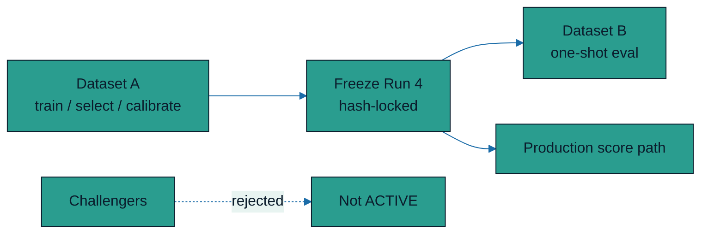

---

## 📊 Benchmark charts (eye-catching)

### Dataset B — high-risk utility (higher is better)

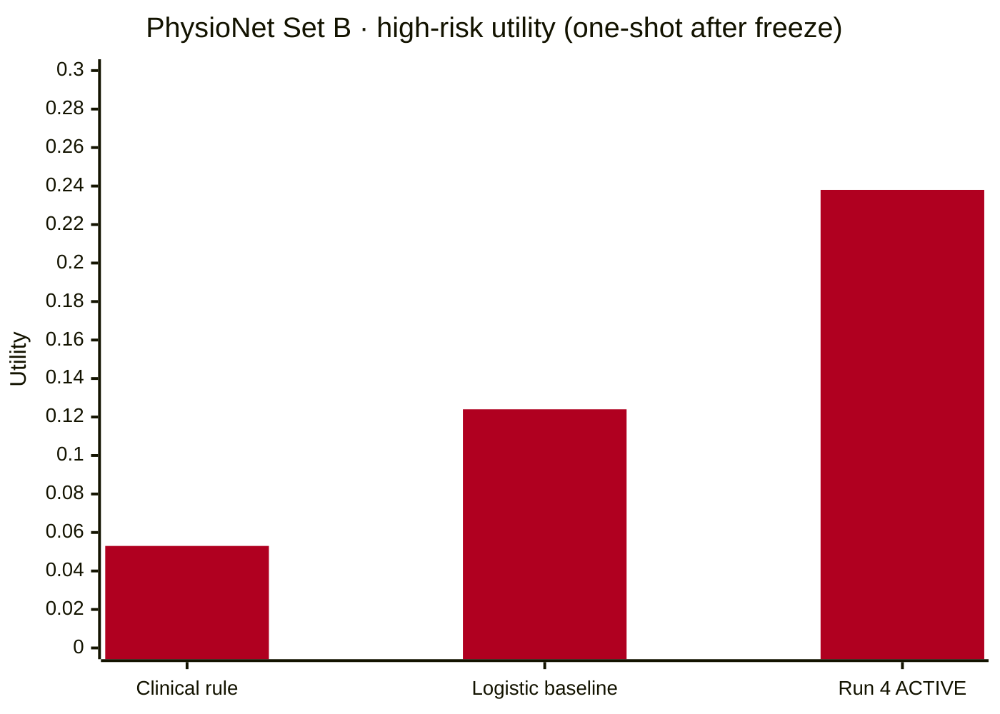

### Discrimination — AUROC

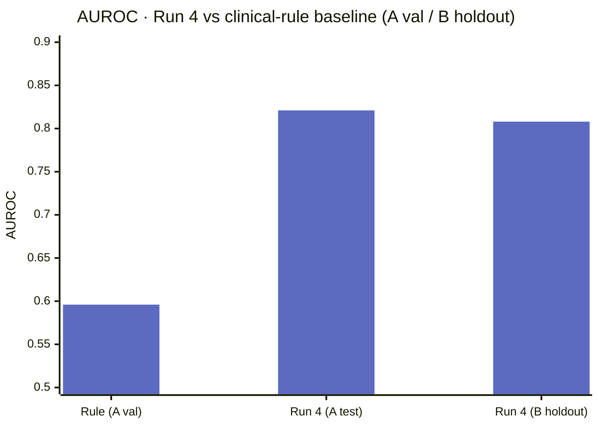

### Scoreboard

| Metric | Clinical rule | Logistic | **Run 4 (ACTIVE)** |
|:-------|:-------------:|:--------:|:------------------:|
| Set B high-risk utility | 0.053 | 0.124 | **0.238** |
| Set B AUROC | — | — | **0.808** |
| Set A test AUROC | — | — | **0.821** |
| Set A test AUPRC | — | — | **0.109** |
| Set B AUPRC | — | — | **0.079** |

> Numbers from `ml/artifacts/models/run4_frozen/metrics.json`, `eval_holdout.json`, and preregistered Set B baselines — **not** Bangladesh hospital outcomes.

---

## 🧪 Models we built & compared

Big nameplates. Only **one** is production.

<p align="center">
  <br/>
  
</p>

<p align="center">
  
  
</p>

<p align="center">
  
  
</p>

<p align="center">
  
</p>

<p align="center">
  
  
  
</p>

<p align="center">
  
  
</p>

<p align="center">
  
  
</p>

<p align="center">
  <br/>
  
</p>

| Family | Run ID | Result | Disposition |
|:-------|:-------|:-------|:------------|
| **LightGBM Run 4** | `RUN4-FROZEN` | B utility **0.238** · AUROC **0.808** | ✅ **ACTIVE** |
| Clinical-rule + logistic | `baselines_setb_*` | Utility 0.053 / 0.124 | Reference |
| LightGBM / CatBoost search | `TABULAR-AONLY-01` | Lost on locked A test | ❌ Rejected |
| Bootstrap ensemble | `RUN4-BOOTSTRAP-ENSEMBLE` | Val util 0.392 vs single 0.402 | ❌ Rejected |
| GRU-D | under `GRAPH-HAZARD-01` | No utility win | ❌ Rejected |
| TCN | under `GRAPH-HAZARD-01` | Best temporal; still below tree | ❌ Rejected |
| Graph-Hazard | `GRAPH-HAZARD-01` | Ablations; no prod win | ❌ Rejected |
| Run 4 + TCN blend | `GRAPH-HAZARD-01` final | AUPRC ↑; utility not | ❌ Rejected |
| Residual-Hazard | `RESIDUAL-HAZARD-01` | B utility 0.109 | ❌ Rejected |
| Transformer | — | No training evidence | 🚫 Not run |
| Qwen 3.5 4B | mapping | LOINC proposals | 🔀 Not scorer |

Full matrix → [docs/EXPERIMENT_MATRIX.md](docs/EXPERIMENT_MATRIX.md)

---

## 📐 Layers — full visual pack

Copied from [docs/LAYERS.md](docs/LAYERS.md) so the story is complete on the landing page.

### L0 — One picture: hospital-local product

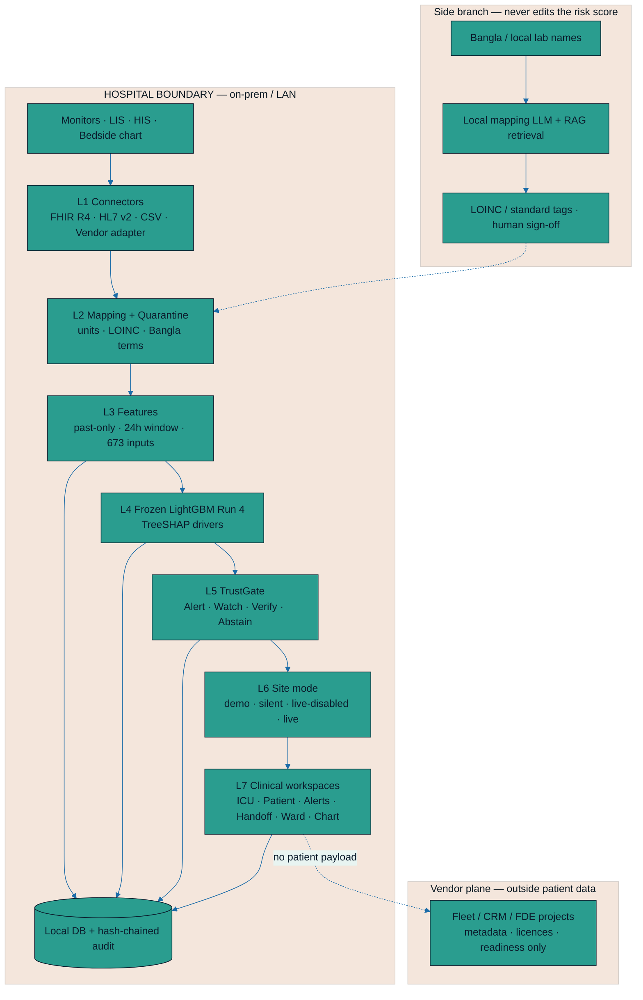

### L1 — Input → AI → Output

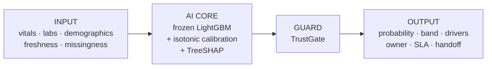

| Step | What happens | Where |
|:-----|:-------------|:------|
| Input | Hourly observations, provenance, units | `backend/app/integrations/` |
| Features | Past-only windows; no future leak | `ml/`, `engine.py` |
| Model | Frozen Run 4 LightGBM | `ml/artifacts/models/run4_frozen/` |
| Guard | Stale / mismatch / gaps → Verify or Abstain | `backend/app/trustgate.py` |
| Output | Score, drivers, ownership, audit | ICU board · patient · alerts |

### Engineering layer badges

| Layer | | Job | Code |
|:------|:--|:----|:-----|
| **L1 Connect** |  | FHIR / HL7 / CSV / quarantine | `backend/app/integrations/` |
| **L2 Map** |  | Bangla/local → LOINC (proposal) | `copilot.py` |
| **L3 Features** |  | Past-only 24h · 673 inputs | `ml/` · `engine.py` |
| **L4 Score** |  | Frozen Run 4 + TreeSHAP | `run4_frozen/` |
| **L5 Guard** |  | TrustGate | `trustgate.py` |
| **L6 Mode** |  | demo · silent · live gates | `site.py` · `pilot.py` |
| **L7 Work** |  | Role workspaces + audit | `frontend/app/` |

### L2 — Safety stack (Responsible AI)

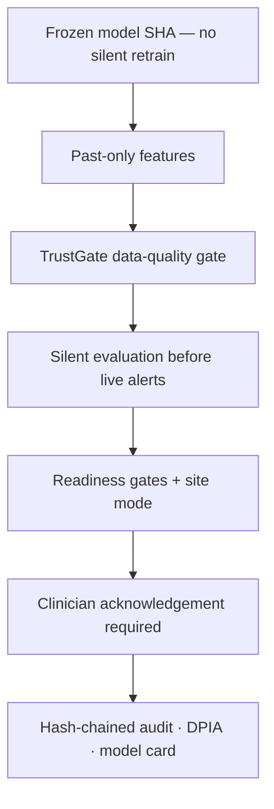

**We do not claim:** saves lives · approved · live hospital EHR on the public demo · auto-retrains · proven false-alarm % reduction.

### L3 — Role-separated planes

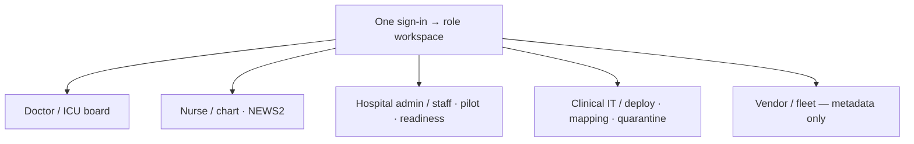

### L4 — Integration / FDE path

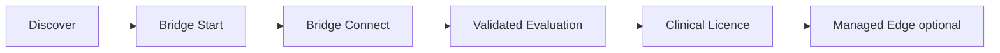

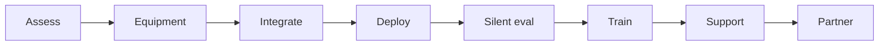

### L5 — Evidence layers

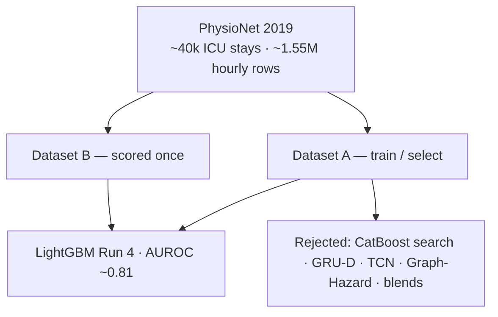

### L6 — Product surfaces (demo)

| Layer | Route | Users |
|:------|:------|:------|
| Public site | `/` | Everyone |
| Sign-in | `/signin` · quick roles | Demo / staff |
| ICU | `/app/icu` | Clinicians |
| Patient | `/patient/BED-*` | Clinicians |
| Alerts / handoff | `/app/alerts` · `/app/handoff` | Care team |
| Ward / chart | `/app/ward` · `/app/chart` | Nurses |
| Deploy | `/deploy` | Clinical IT |
| Vendor | `/platform` · fleet | Auralis ops |

### L7 — Congress pitch map

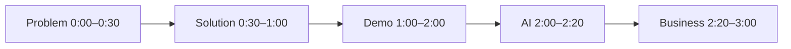

---

## 🛡️ TrustGate & safety

| State | |
|:------|:--|
|  | Interruptive path allowed when data + model agree |
|  | Elevated — monitor |
|  | Quality / freshness / unit issue |
|  | Do not interrupt |

Deterministic gate in `backend/app/trustgate.py` — **not** an LLM.  
Honest limit: false-alert *benefit* at matched sensitivity is **not** statistically established.

---

## 🏗️ Systems & architecture

| Plane | Stack | Notes |
|:------|:------|:------|
| Clinical API | FastAPI · SQLAlchemy | `/v1/*` · OpenAPI at `/docs` |
| UI | Next.js · Tailwind · ECharts | Public + hospital + vendor |
| Auth | Local / OIDC / demo roles | Doctor · nurse · admin · clinical IT |
| Audit | Hash-chained | Hospital-local |
| MCP | 3 read-only servers | Ops · docs · mapping — **no PHI** |
| Edge | Optional HL7 MLLP | `edge/` |
| Image | `tanvirdoc02/predictrx-sentinel` | Public synthetic demo |

```
backend/   FastAPI · TrustGate · connectors · scoring
frontend/  Next.js · Auralis UI · /docs hub
ml/        Pipeline · frozen Run 4 · (local) challengers
docs/      Cards · ledger · layers · Pages hub · FDE
mcp-server/  Read-only MCP
control-plane/  Patient-free vendor fleet
infra/     Docker · Congress preflight
demo/      Replay assets
```

---

## ⚠️ Gaps & risks

Highlights from [docs/GAPS_AND_RISKS.md](docs/GAPS_AND_RISKS.md):

| Item | Label |
|:-----|:------|
| Challenger artifacts mostly gitignored |  |
| Transfer Shield S7 |  — not a separate auto-stop service |
| Public demo ≠ live EHR |  |
| Pricing / paid pilots / grants |  |

---

## 🚀 FDE service lifecycle

| Stage | Intent | Status |
|:------|:-------|:-------|
| **Discover** | Workflow + infra readiness | Implemented surfaces |
| **Bridge Start** | CSV / batch | Implemented |
| **Bridge Connect** | HL7 / FHIR | Implemented + edge |
| **Validated Evaluation** | Silent / retrospective | Protocol — **no paid pilot claimed** |
| **Clinical Workflow Licence** | Annual site |  |
| **Managed Edge** | Local ops | Playbooks / FDE |
| **Expansion** | More sites | Roadmap |

---

## 📦 Deep evidence — link boxes

Long dossiers stay in `docs/` — open from these colorful cards:

<table>
  <tr>
    <td width="50%">
      <a href="docs/DOCUMENTATION_INDEX.md"></a><br/>
      Who opens what · judges / ML / IT / FDE
    </td>
    <td width="50%">
      <a href="docs/LAYERS.md"></a><br/>
      Same Mermaid pack as above · standalone page
    </td>
  </tr>
  <tr>
    <td>
      <a href="docs/EXPERIMENT_MATRIX.md"></a><br/>
      Run IDs · configs · hashes · dispositions
    </td>
    <td>
      <a href="docs/GAPS_AND_RISKS.md"></a><br/>
      Open history · engineering gaps
    </td>
  </tr>
  <tr>
    <td>
      <a href="docs/model-card.md"></a><br/>
      Intended use · limits · metrics
    </td>
    <td>
      <a href="docs/data-card.md"></a><br/>
      Splits · leakage controls · Dataset B
    </td>
  </tr>
  <tr>
    <td>
      <a href="docs/experiment-ledger.md"></a><br/>
      What was trained · rejected · frozen
    </td>
    <td>
      <a href="docs/judge-evidence-matrix.md"></a><br/>
      Congress claim map
    </td>
  </tr>
  <tr>
    <td>
      <a href="docs/trustgate-layers.md"></a><br/>
      Alert · Watch · Verify · Abstain
    </td>
    <td>
      <a href="docs/safety-ethics.md"></a><br/>
      + <a href="docs/safety-case.md">safety-case</a>
    </td>
  </tr>
  <tr>
    <td>
      <a href="docs/architecture.md"></a><br/>
      + <a href="docs/architecture/current-state-audit.md">current-state audit</a>
    </td>
    <td>
      <a href="docs/integration.md"></a><br/>
      Connectors · quarantine · spool
    </td>
  </tr>
  <tr>
    <td>
      <a href="docs/operations.md"></a><br/>
      + <a href="docs/operator-guide.md">operator-guide</a>
    </td>
    <td>
      <a href="docs/frontend-how-to-use.md"></a><br/>
      Surfaces · roles · demo paths
    </td>
  </tr>
  <tr>
    <td>
      <a href="docs/innovation-adoption-barriers.md"></a><br/>
      Site readiness · S7 honesty note
    </td>
    <td>
      <a href="docs/business/business-model.md"></a><br/>
      + FDE playbook · pricing assumptions
    </td>
  </tr>
  <tr>
    <td>
      <a href="docs/business/fde-delivery-playbook.md"></a>
    </td>
    <td>
      <a href="REAL_WORLD_ACTION_PLAN.md"></a>
    </td>
  </tr>
  <tr>
    <td>
      <a href="AGENTS.md"></a>
    </td>
    <td>
      <a href="https://tanvir-ahmed-siddique-ctrl.github.io/Sepsis/"></a>
    </td>
  </tr>
  <tr>
    <td>
      <a href="docs/auralis-copilot-byo-llm.md"></a><br/>
      n8n decision · RAG scope · Bangla policy · credentials
    </td>
    <td>
      <a href="docs/business/business-model.md"></a><br/>
      Also inlined in README · pricing assumptions internal
    </td>
  </tr>
</table>

---

## 📈 KPIs & business (hypothesis · not revenue claims)

> **Label:** planning / discovery ranges only. Pre-revenue research prototype.  
> No paid pilots, signed ARR, or clinical outcome ROI is claimed. Figures from internal hypotheses in `docs/business/*` — **not** validated willingness-to-pay.

### Commercial funnel (site-by-site FDE)

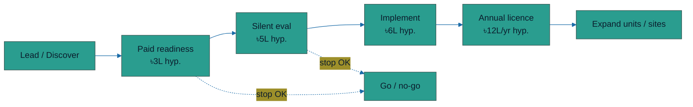

### Package mix — discovery BDT ranges (lakh)

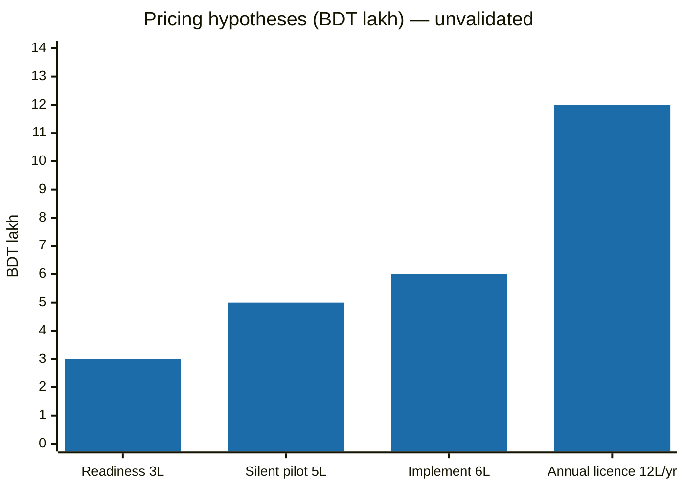

### What we track as **product KPIs** (ops · not “lives saved”)

| KPI family | Examples we instrument / plan | Never use as sales claim |
|:-----------|:------------------------------|:-------------------------|
| **Data quality** | TrustGate Verify/Abstain rates · feed freshness · unmapped codes | “% false alarms reduced” without matched study |
| **Workflow** | Alert ack SLA · handoff completion · trained users / shift | Mortality reduction |
| **Integration** | Connector uptime · quarantine queue · mapping reuse | Live EHR without MoU |
| **Evidence** | Silent-eval protocol adherence · Set B one-shot discipline | Bangladesh AUROC without local data |
| **Commercial** | Pipeline stage · readiness→pilot conversion · renewal intent | ARR without signed contracts |

### Value story (honest)

| Layer hospitals pay for | Why it can sell before local model proof |
|:------------------------|:-----------------------------------------|
| **Bridge + TrustGate** | Makes vitals arrive + refuses bad interrupts |
| **Silent evaluation** | Local evidence gate before alerts |
| **Managed Edge / FDE** | Install, train, support — enablement not SaaS fantasy |
| **Frozen Run 4 licence** | Only after local readiness + governance | 

Deep dive (hypothesis-aware): [business-model](docs/business/business-model.md) · [pricing-assumptions](docs/business/pricing-assumptions.md) · [strategic-plan](docs/business/strategic-plan.md) · [FDE playbook](docs/business/fde-delivery-playbook.md)

---

## 🗣️ Language policy · বাংলা UI + English clinical terms

We **already ship** an EN ⇄ বাংলা toggle (`frontend/lib/copy.ts`, nav button).

| Surface | Language | Why |
|:--------|:---------|:---|
| Menus, buttons, empty states, disclaimers | **Bangla or English** (user choice) | Staff comfort |
| Disease / syndrome names, LOINC, SNOMED-ish labels, drug class names | **Keep English (Latin script)** | Shared charting language · reduces mistranslation risk |
| Local lab slang on paper (নাড়ি, RBS, Hb%) | **Accepted as input** → mapped to English canonical codes | Mapping copilot + synonyms |
| Risk bands / TrustGate states | Dual: Bangla gloss + **English code** in audit | Audit interoperability |

**Does Bangla look “bad”?** No — Bangla chrome + English medical tokens is standard for BD clinical software and reads *more* professional than inventing unstable Bangla disease neologisms on an ICU board.

---

## 🧩 Why not n8n? Do we use RAG?

| Tool / pattern | Did we use it? | Why |
|:---------------|:---------------|:----|
| **n8n** | **No** | Hospital edge needs deterministic connectors, quarantine, audit, and offline CPU — not a general workflow SaaS. HL7/FHIR/CSV live in `backend/app/integrations/` + optional `edge/` MLLP. n8n would add another moving part, weaker audit story, and cloud temptation. |
| **RAG** | **Yes — for mapping only** | Hybrid lexical + embedding retrieval + RRF over the LOINC registry (`backend/app/integrations/copilot.py`). LLM may **only choose among retrieved candidates**. |
| **RAG over patient chart for diagnosis** | **No** | Would blur into treatment advice; sepsis score stays frozen LightGBM + TrustGate. |

Design for optional cloud assist + co-pilot scope: **[docs/auralis-copilot-byo-llm.md](docs/auralis-copilot-byo-llm.md)**

---

## 🤖 Auri AI (local co-pilot · licence-bundled cloud optional)

<p align="center">
  
  
  
</p>

**Language:** header **Language** dropdown (`English` / `বাংলা`) — medical terms stay English.  
**Auri AI:** mapping + explainers (+ gated drafts). Cloud assist is **bundled into the hospital deal** when quoted — admin installs the key on the **local server** (`/app/admin/setup`), not in the browser.  
**Profile → Auri AI** for clinicians · **Hospital setup → Auri AI** for admin/IT.

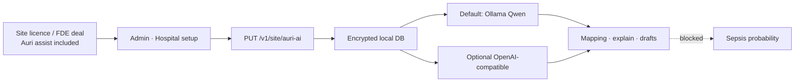

Plan + security → [docs/auralis-copilot-byo-llm.md](docs/auralis-copilot-byo-llm.md) · product → [/aurie](https://predictrx-sentinel-demo.onrender.com/aurie)

---

## Quick start

```powershell
Set-Location "…\PredictRx Sentinel"
py -3.11 -m venv .venv
.\.venv\Scripts\Activate.ps1
pip install -r ml\requirements.txt
pip install -e .\ml
pip install -r backend\requirements.txt
Set-Location backend
alembic upgrade head
uvicorn app.main:app --reload
# other terminal → frontend: npm ci && npm run dev
```

- UI → http://localhost:3000  
- API → http://localhost:8000/docs  
- Demo image → `docker build --platform linux/amd64 -f infra/Dockerfile.demo -t tanvirdoc02/predictrx-sentinel:latest .`

---

## Limitations

- US PhysioNet ≠ Bangladesh ICU reality  
- No clinical outcome improvement claimed  
- TrustGate alert-burden benefit unproven at matched sensitivity  
- Live HIS needs MoU + legal basis + FDE work outside this repo  
- Frozen Run 4 is **immutable** until a new ledgered promotion  
- Business figures in this README are **hypotheses**, not booked revenue  

---

## Disclaimer

Trained on publicly available US ICU data. **Not** for clinical use. **Not** a live hospital EHR integration on the public demo. Patient data is never a product for sale.
