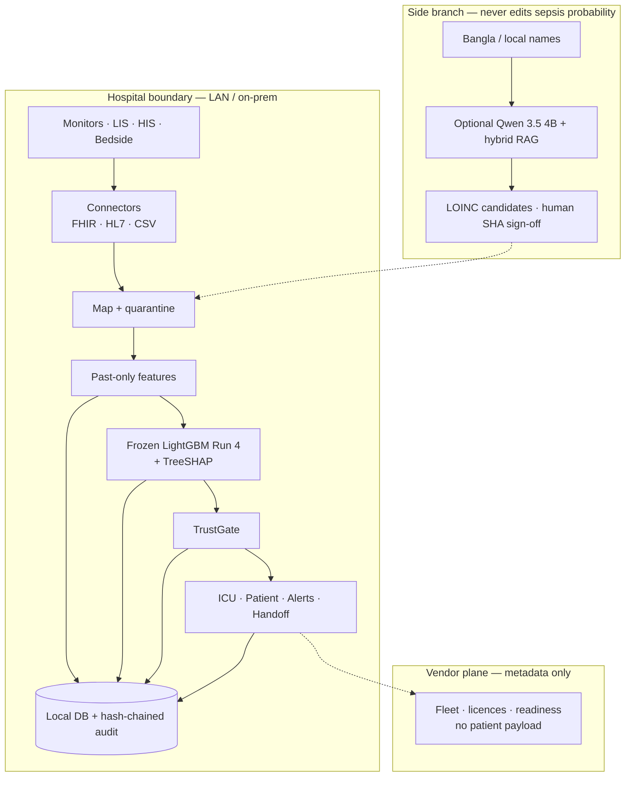
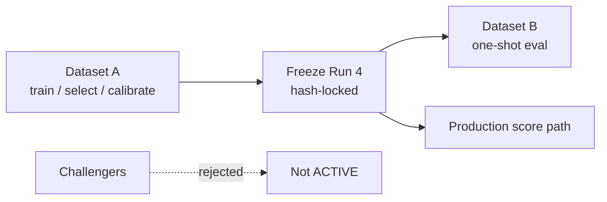

# Auralis

**Hospital-local ICU early-warning intelligence** with forward-deployed engineering.  
Public brand: **Auralis** · Research track: **PredictRx Sentinel**

<p align="center">
  <strong>Research prototype — not approved for clinical use.</strong><br/>
  Public demo = synthetic / PhysioNet replay only. Risk scores support clinical judgment; they do not replace it.<br/>
  Not validated on Bangladeshi patients. No claim of lives saved, paid pilots, or regulatory approval.
</p>

| | |
|---|---|
| **Live demo** | https://predictrx-sentinel-demo.onrender.com |
| **In-app docs** | `/docs` (live model hash + architecture) |
| **API OpenAPI** | Demo `/api/docs` (Swagger; FastAPI `/docs` behind the proxy) |
| **GitHub Pages** | https://tanvir-ahmed-siddique-ctrl.github.io/Sepsis/ |
| **Layers** | [docs/LAYERS.md](docs/LAYERS.md) |
| **Experiment matrix** | [docs/EXPERIMENT_MATRIX.md](docs/EXPERIMENT_MATRIX.md) |
| **Doc index** | [docs/DOCUMENTATION_INDEX.md](docs/DOCUMENTATION_INDEX.md) |
| **Challenge** | HealthSphere AI · PredictRx · International AI Builders Congress 2026 |

---

## What it is

Auralis is an **on-premises decision-support stack** for adult ICU early warning:

1. **Connect** hospital feeds (FHIR R4, HL7 v2, CSV) with unit/LOINC quarantine  
2. **Score** with a **frozen** LightGBM model (past-only features, TreeSHAP drivers)  
3. **Guard** with **TrustGate** (Alert / Watch / Verify data / Abstain) before interruptive alerts  
4. **Work** in role-separated doctor, nurse, admin, and clinical-IT surfaces  
5. **Deploy** site-by-site via forward-deployed engineering — not a cloud EHR plug-in fantasy  

A **side branch** (never the score path) uses optional on-prem Qwen for Bangla / local lab → LOINC proposals with human sign-off.

---

## System architecture



More diagrams (roles, safety stack, Congress I→AI→O): **[docs/LAYERS.md](docs/LAYERS.md)**.

---

## Seven-layer engineering map

| Layer | Responsibility | Evidence |
|-------|----------------|----------|
| **L1 Connect** | FHIR / HL7 / CSV, idempotency, quarantine | `backend/app/integrations/` |
| **L2 Map** | Local/Bangla → LOINC (proposal only) | `backend/app/integrations/copilot.py` |
| **L3 Features** | Past-only 24h window; no future leak | `ml/`, `backend/app/services/engine.py` |
| **L4 Score** | Frozen LightGBM Run 4 + isotonic + TreeSHAP | `ml/artifacts/models/run4_frozen/` |
| **L5 Guard** | TrustGate Verify / Abstain | `backend/app/trustgate.py` |
| **L6 Mode** | demo · silent · readiness gates | `backend/app/site.py`, `pilot.py` |
| **L7 Work** | Role workspaces + audit | `frontend/app/` |

---

## ML evidence (what was actually decided)

**Active artifact only:** Frozen LightGBM **Run 4** `v0.2.0-202609281906`

| | |
|---|---|
| SHA-256 | `a7dcf5f4b2f00927c17d2468cba144b3db4642ccb5a9c946b484958a0413532d` |
| Pointer | `ml/artifacts/models/ACTIVE.json` → `run4_frozen/model.joblib` |
| Train | PhysioNet Challenge 2019 Dataset A (patient split, seed 42) |
| Holdout | Dataset B scored **once** after freeze — AUROC **0.808**, high-risk utility **0.238** (beats preregistered clinical-rule / logistic baselines) |
| Calibration | Isotonic on A validation; B slope ~0.80 → local recalibration required before any live use |

**Rejected for production** (artifacts / ledger exist; not the live scorer): 36-trial LightGBM/CatBoost search · GRU-D · TCN · Graph-Hazard ablations · Run4+TCN blend · Residual-Hazard · same-family bootstrap ensemble.

**Not claimed:** a trained time-series Transformer (no evidence in repo).  
**Qwen** is terminology normalization — **not** the sepsis-risk model.

Full table: **[docs/EXPERIMENT_MATRIX.md](docs/EXPERIMENT_MATRIX.md)** · narrative: [experiment-ledger](docs/experiment-ledger.md) · [model-card](docs/model-card.md) · [data-card](docs/data-card.md).



---

## TrustGate & site readiness

**TrustGate** is a deterministic data-quality gate on every score: coverage, freshness, unit/shift signals → **Alert / Watch / Verify data / Abstain**.  
Code: `backend/app/trustgate.py`. Docs: [trustgate-layers](docs/trustgate-layers.md).  
Honest limit: at matched sensitivity, false-alert *benefit* is **not** statistically established.

**Transfer Shield / readiness** (silent pilot, freeze, quarantine, habit fingerprint, context policy) is implemented as site gates and product surfaces — see [innovation-adoption-barriers](docs/innovation-adoption-barriers.md).  
**S7 subgroup stop** is primarily a fairness-audit governance trigger (`docs/evidence/fairness-audit.md`), not a separate auto-stop microservice. Playbook “S0–S8” proposals are **not** the same taxonomy as the shipped product labels.

---

## Local terminology AI (isolated)

| | |
|---|---|
| Runtime | Optional Ollama `qwen3.5:4b` + optional embeddings |
| Job | Propose Bangla / BD lab aliases → LOINC from retrieved candidates only |
| Contract | JSON schema; out-of-candidate answers discarded; human registry SHA |
| Isolation | Score path never calls the LLM (`engine.py` → frozen joblib only) |

Benchmark (internal): [docs/evaluation/copilot-retrieval-bench-v1.json](docs/evaluation/copilot-retrieval-bench-v1.json).

---

## Backend, frontend, security

| Plane | Stack | Notes |
|-------|--------|------|
| Clinical API | FastAPI · SQLAlchemy · SQLite/Postgres | `/v1/*`, OpenAPI at `/docs` |
| UI | Next.js · TypeScript · Tailwind · ECharts | Public site + hospital app + vendor portal |
| Auth | Local accounts / OIDC / demo roles | Doctor · nurse · admin · clinical IT · operator |
| Audit | Hash-chained prediction / action log | Hospital-local |
| MCP | 3 read-only servers | Ops · docs · mapping — **no PHI tools** (`mcp-server/`) |
| Edge | Optional HL7 MLLP / spool | `edge/` |

Route & role matrices: `docs/architecture/`.

---

## Synthetic public demo vs hospital-local design

| | Public demo | Intended hospital install |
|---|-------------|---------------------------|
| Data | PhysioNet replay + synthetic | Hospital-local observations only |
| Mode | `demo` | Silent → gated live |
| EHR | **Not** a live hospital integration | FHIR / HL7 / CSV connectors on LAN |
| Vendor | N/A | Metadata-only fleet heartbeat |

Deployment guides: [operator-guide](docs/operator-guide.md) · [operations](docs/operations.md) · Compose: `docker-compose.yml` + `docker-compose.site.yml`.

---

## FDE service lifecycle (business model)

Auralis is positioned as **hospital technology enablement**, not model-file licensing alone.

| Stage | Intent | Status label |
|-------|--------|----------------|
| **Discover** | Workflow + infrastructure readiness | Implemented as product surfaces / checklists |
| **Bridge Start** | CSV / batch | Implemented connectors |
| **Bridge Connect** | HL7 / FHIR / approved APIs | Implemented + edge path |
| **Validated Evaluation** | Silent / retrospective under governance | Protocol + pilot gates; **no paid pilot claimed** |
| **Clinical Workflow Licence** | Annual site licence | **Commercial hypothesis** |
| **Managed Edge** | Local install + ops | Playbooks; delivery is FDE work |
| **Expansion** | More units / sites | Hypothesis / roadmap |

Details: [business-model](docs/business/business-model.md) · [fde-delivery-playbook](docs/business/fde-delivery-playbook.md).  
Outside-repo blockers: [REAL_WORLD_ACTION_PLAN.md](REAL_WORLD_ACTION_PLAN.md).  
Pricing / market / grants = **hypotheses** unless separately evidenced.

---

## Repo layout

```
backend/        FastAPI · TrustGate · connectors · scoring
frontend/       Next.js · Auralis UI · /docs hub
ml/             Pipeline · frozen Run 4 · (local) challenger artifacts
docs/           Cards · ledger · layers · FDE · evidence
mcp-server/     Read-only operator / docs / mapping MCP
control-plane/  Patient-free vendor fleet
infra/          Docker · Congress preflight
edge/           Optional HL7 edge relay
knowledge/      Versioned non-causal evidence graphs
demo/           Replay assets (manifest + samples)
```

---

## Quick start

```powershell
Set-Location "…\PredictRx Sentinel"
py -3.11 -m venv .venv
.\.venv\Scripts\Activate.ps1
pip install -r ml\requirements.txt
pip install -e .\ml
pip install -r backend\requirements.txt

# API
Set-Location backend
alembic upgrade head
uvicorn app.main:app --reload

# UI (other terminal)
Set-Location frontend
npm ci
npm run dev
```

- UI: http://localhost:3000  
- API OpenAPI: http://localhost:8000/docs  
- Tests: `cd backend && pytest -q` · `cd frontend && npm test`  
- Compose: `docker compose up --build`  
- Congress preflight: `python infra\congress_demo.py check`

---

## Documentation map

Prefer the curated index over dumping every markdown file:

→ **[docs/DOCUMENTATION_INDEX.md](docs/DOCUMENTATION_INDEX.md)**

Core set: [LAYERS](docs/LAYERS.md) · [EXPERIMENT_MATRIX](docs/EXPERIMENT_MATRIX.md) · [DOCUMENTATION_INDEX](docs/DOCUMENTATION_INDEX.md) · [GAPS_AND_RISKS](docs/GAPS_AND_RISKS.md) · [architecture](docs/architecture.md) · [trustgate](docs/trustgate-layers.md) · [judge-evidence-matrix](docs/judge-evidence-matrix.md) · [safety-ethics](docs/safety-ethics.md) · [AGENTS.md](AGENTS.md)

---

## Limitations & roadmap

- US PhysioNet training distribution ≠ Bangladesh ICU reality  
- No claim of clinical outcome improvement  
- TrustGate alert-burden benefit unproven at matched sensitivity  
- Live HIS connection requires hospital MoU, legal basis, and FDE work outside this repo  
- Frozen Run 4 is **immutable** — challengers stay off `ACTIVE.json` until a new ledgered promotion  

---

## Disclaimer

Trained on publicly available US ICU data. **Not** for clinical use. **Not** a live hospital EHR integration on the public demo. Patient data is never a product for sale.
