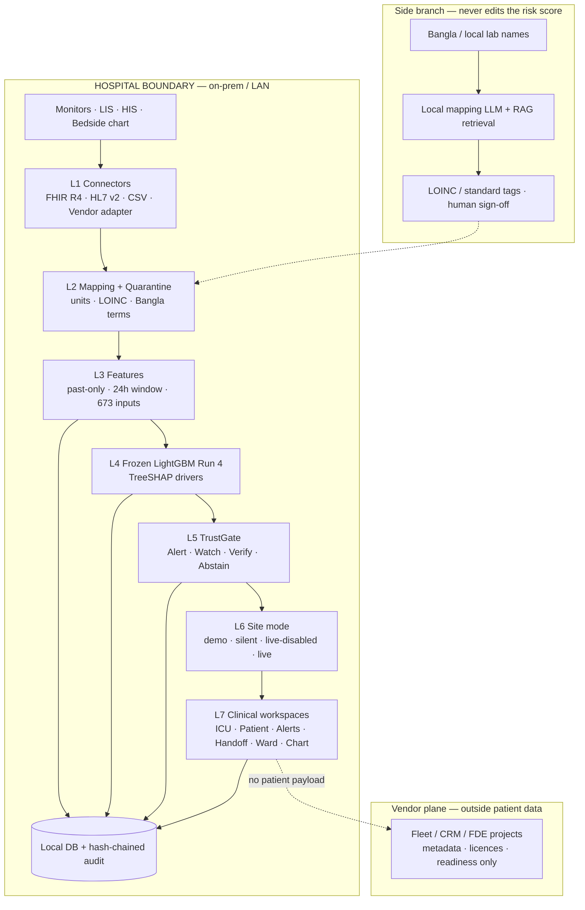
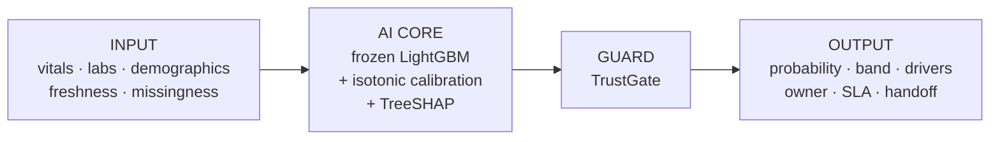
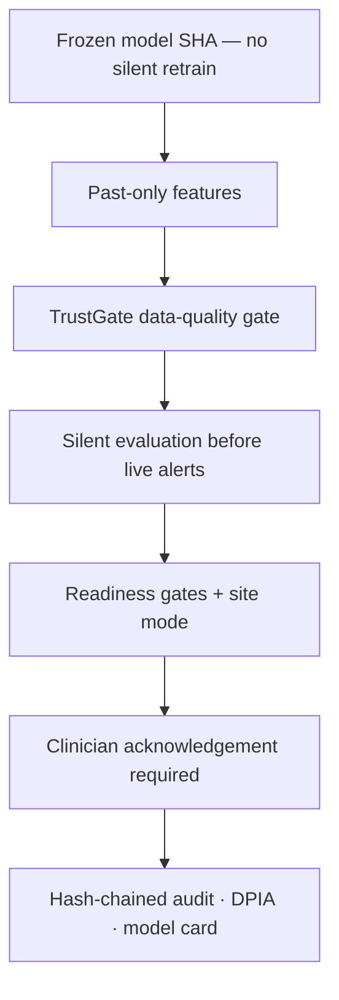
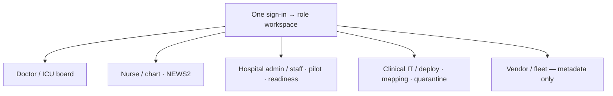
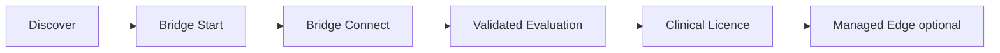
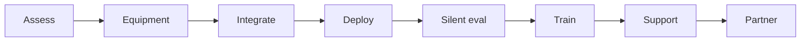
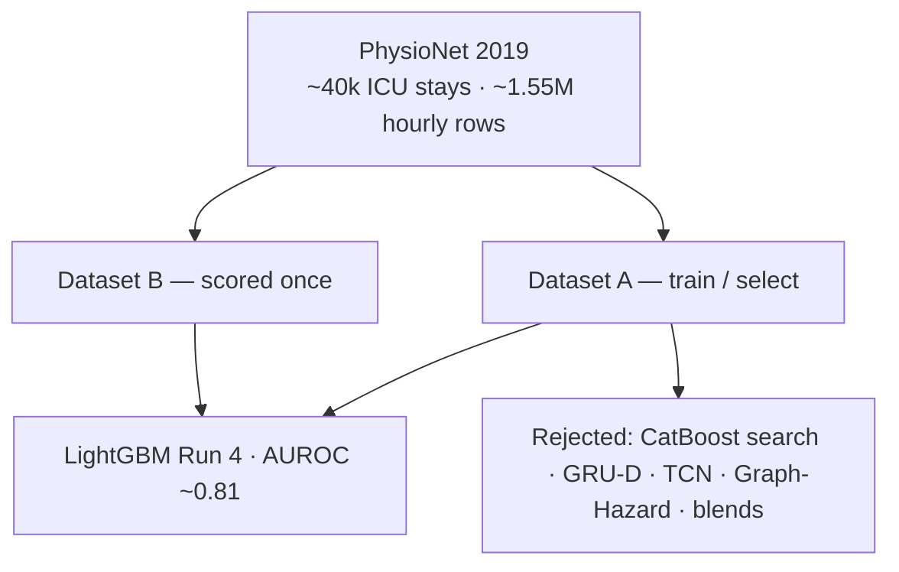
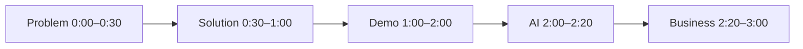

# Auralis — system layers (visual)

> Research prototype · synthetic / PhysioNet replay on the public demo · **not approved for clinical use**.  
> Patient data stays inside the hospital boundary. Vendor sees **metadata only**.

GitHub renders these diagrams on this page. Start here if a judge asks “show me the layers.”

---

## L0 — One picture: hospital-local product

---

## L1 — Input → AI → Output (Congress mandatory flow)

| Step | What happens | Where in repo |
|------|----------------|---------------|
| Input | Hourly observations, provenance, units | `backend/app/integrations/`, charting |
| Features | Past-only windows; no future leak | `ml/`, `backend/app/services/engine.py` |
| Model | Frozen Run 4 LightGBM | `ml/artifacts/`, model card |
| Guard | Stale / mismatch / gaps → Verify or Abstain | `backend/app/trustgate.py` |
| Output | Score, drivers, alert ownership, audit | ICU board, patient, alerts |

---

## L2 — Safety stack (Responsible AI)

**We do not claim:** saves lives · approved · live hospital connection · auto-retrains · false-alarm % reduction as proven.

---

## L3 — Role-separated planes

Roles never share the same clinical screens. Crossing into another plane requires that identity.

---

## L4 — Integration path (worldwide, site by site)

| Track | What we do |
|-------|------------|
| Small / mid hospitals | Enable infrastructure + coordinate missing devices |
| Large / mature hospitals | Integrate existing EHR / HIS feeds |

---

## L5 — Evidence layers (honest numbers)

Details: [model card](model-card.md) · [data card](data-card.md) · [experiment ledger](experiment-ledger.md)

---

## L6 — Product surface (demo paths)

| Layer | Route / surface | Users |
|-------|-----------------|-------|
| Public site | `/` splash · hero · connect story | Everyone |
| Sign-in | `/signin` quick roles | Demo / staff |
| ICU | `/app/icu` | Clinicians |
| Patient | `/patient/BED-*` | Clinicians |
| Alerts / handoff | `/app/alerts` · `/app/handoff` | Care team |
| Ward / chart | `/app/ward` · `/app/chart` | Nurses |
| Deploy | `/deploy` | Clinical IT |
| Admin | admin / pilot / staff | Hospital admin |
| Vendor | `/platform` · control-plane | Auralis ops |
| Book | `/contact` | Hospitals |

Live demo (synthetic): https://predictrx-sentinel-demo.onrender.com

---

## L7 — Congress submission map

| Package piece | Where |
|---------------|--------|
| Problem / users | Pitch VO + product brief |
| AI architecture | **This page** + [architecture](architecture.md) |
| Data & sovereignty | [data card](data-card.md) · [DPIA](data-protection-impact-assessment.md) · on-prem boundary |
| Demo | Live Render site (pitch video local only — not in Git) |
| Scalability | [scalability](scalability.md) · FDE packages · worldwide site-by-site |
| Ethical safeguards | [safety-ethics](safety-ethics.md) · TrustGate · frozen model |

Checklist: [submission wrap-up](submission/WRAP_UP_CHECKLIST.md)
